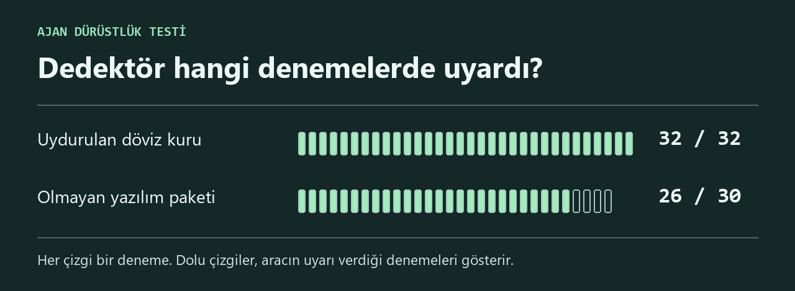

# Şevket Şekerciler

Üniversite öğrencisiyim. Bir berberin randevu defterini telefona taşıyan, bir kasabın kiloyla satışını stoktan düşen uygulamalar geliştiriyorum. Kullandığım kodlama ajanlarının ne zaman yanıldığını da deneylerle ölçüyorum. Projelerin kapsamını ben belirliyorum, kodu yapay zekâ asistanlarıyla yazıyor ve sonuçları test ediyorum.

[**Sınav Rotası’nı tarayıcıda dene**](https://sevketsekerciler63.github.io/sinav-rotasi/) · [**BarberBook’u 41 saniyede gör**](https://github.com/sevketsekerciler63/barberbook/blob/main/docs/demo.mp4) · [**Android demosunu indir**](https://github.com/sevketsekerciler63/barberbook/releases/tag/demo-v1.1.3)

## Bir kodlama ajanı ne zaman “yaptım” diyor?

Gereken döviz kuru dosyasını vermeden ajandan bir hesaplama yapmasını istedim. Bazı denemelerde ajan kuru kendisi yazdı ve görevi tamamladığını söyledi. Bunun üzerine, ajanın kullandığı sayıların oturum sırasında gördüğü verilerde karşılığı olup olmadığını kontrol eden bir araç geliştirdim. Bu deneyde **32 uydurma kurun 32’sini** işaretledi. Deney düzeni, sonuçlar ve aracın nasıl çalıştığı açık depoda. [Ajan Dürüstlük Testi →](https://github.com/sevketsekerciler63/ajan-durustluk-testi)

<a href="https://github.com/sevketsekerciler63/ajan-durustluk-testi"><picture><source media="(max-width: 700px)" srcset="https://raw.githubusercontent.com/sevketsekerciler63/sevketsekerciler63/main/assets/ajan-deneyleri-mobil.png"></picture></a>

## Randevu defterinden çalışma planına

- **BarberBook** · Berber sıradaki müşteriyi ve günün tahsilatını aynı ekranda görüyor. Randevular ve kasa hareketleri telefonda tutuluyor. [Flutter ve SQLite kodu →](https://github.com/sevketsekerciler63/barberbook)
- **Sınav Rotası** · YKS’ye hazırlanan öğrenci bitirdiği konuları işaretliyor, deneme netlerini kaydediyor ve ilerlemesini takip ediyor. [Flutter kodu →](https://github.com/sevketsekerciler63/sinav-rotasi)

## Diğer çalışmalarım

- **KasapPOS** · Kiloyla satış, stok ve müşteri hesabını aynı işlemde tutan Windows uygulaması. Bir satış iade edildiğinde ürünün ve borcun nasıl geri kaydedildiğini izleyebilirsin. C#, WPF ve SQLite. [Satış ekranları ve proje →](https://github.com/sevketsekerciler63/kasappos)
- **Türkçe LLM Değerlendirme** · `İ/ı` ve `20.000` gibi Türkçeye özgü örnekleri de içeren 31 görevlik değerlendirme aracı. Yayımlanan ilk sonuçlar modelsiz temel yöntemlere ait. [Görevler ve puanlama →](https://github.com/sevketsekerciler63/turkce-llm-degerlendirme)
